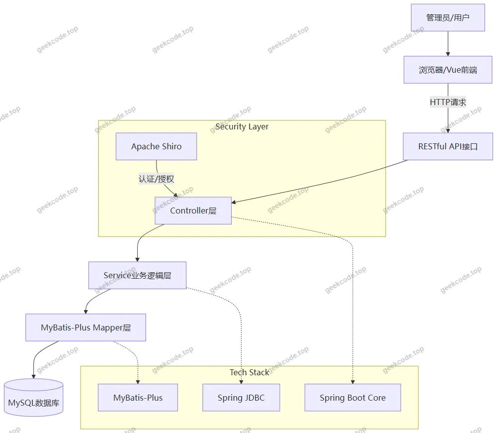
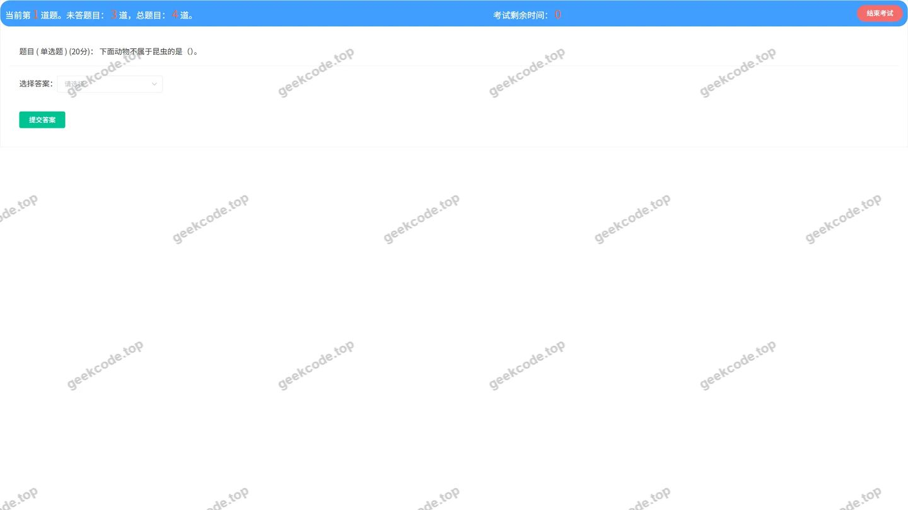
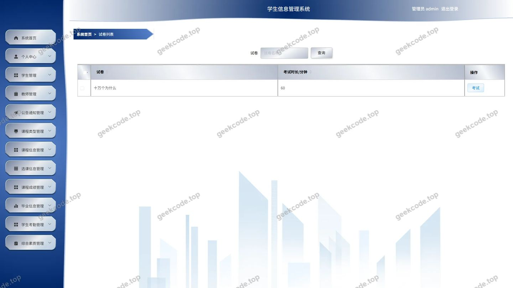
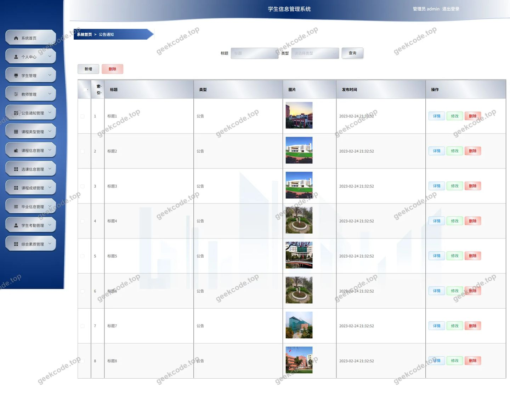
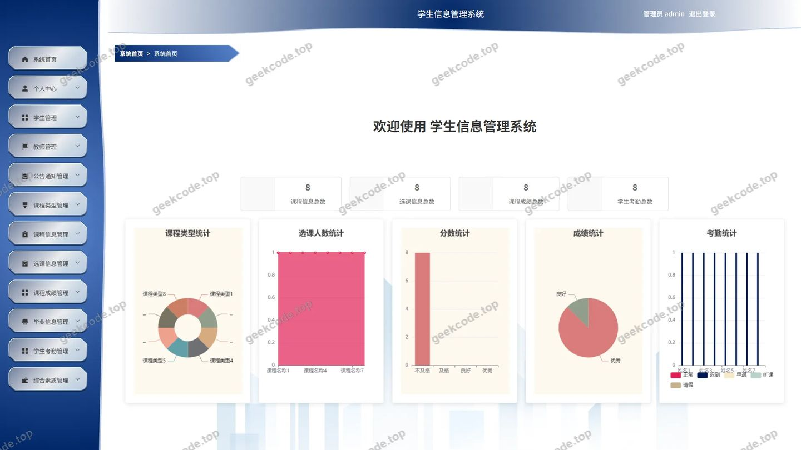
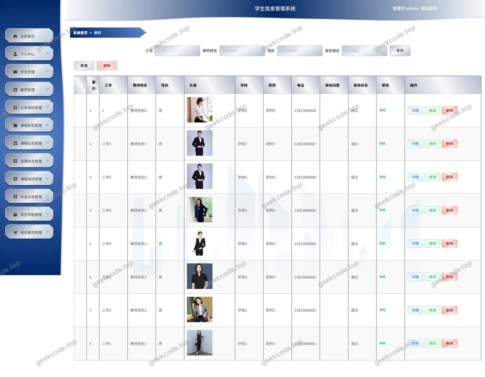
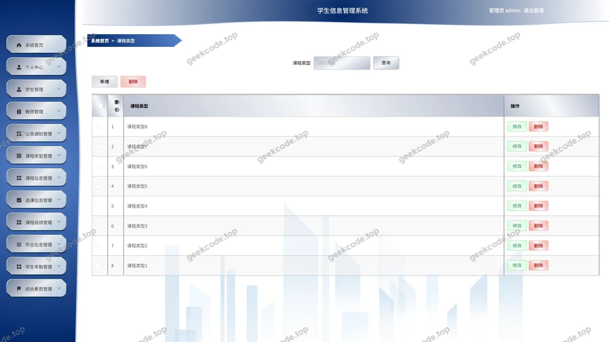
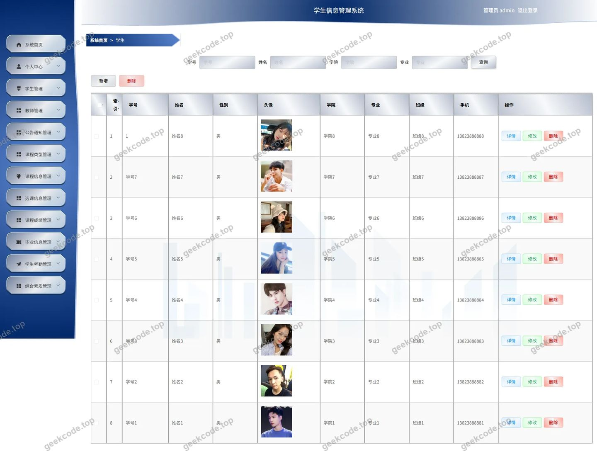
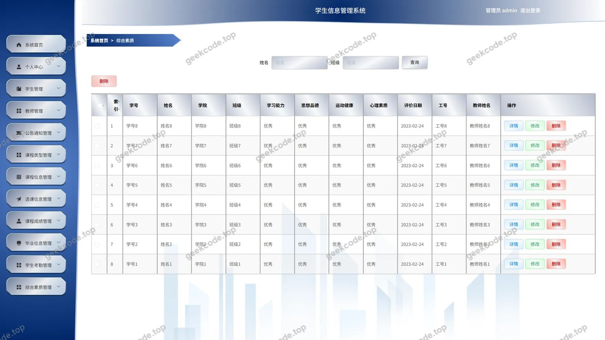

# 学生信息管理系统06bg9--论文

> 🎓 **计算机毕业设计 · 学生信息管理系统06bg9--论文**
>
> 本仓库只放**项目介绍 + 运行截图**（截图是站点带水印的原图，存在仓库 `images/` 里）。
>
> 👉 **完整可运行源码 / 数据库脚本 / 部署文档：[点我获取](https://geekcode.top/archives/%E5%AD%A6%E7%94%9F%E4%BF%A1%E6%81%AF%E7%AE%A1%E7%90%86%E7%B3%BB%E7%BB%9F06bg9-%E8%AE%BA%E6%96%87?utm_source=github)**
>
> 💬 咨询微信：**ir9372**　|　🌐 更多项目：[极客代码 geekcode.top](https://geekcode.top/?utm_source=github)
>
> 📌 项目详情页：<https://geekcode.top/archives/%E5%AD%A6%E7%94%9F%E4%BF%A1%E6%81%AF%E7%AE%A1%E7%90%86%E7%B3%BB%E7%BB%9F06bg9-%E8%AE%BA%E6%96%87?utm_source=github>

<table><td width="230" align="center"> <b>扫码加微信 ir9372</b></td><td valign="middle">📦 源码 = 项目介绍 + 全部运行截图 + 数据库 + 部署文档 👉 点上方任意截图，直接跳到 <b>极客代码 geekcode.top</b> 详情页</td></table>

---

<h1>学生信息管理系统_06bg9--论文</h1>
<h2>项目概述</h2>

本项目为“学生信息管理系统”，旨在构建一个基于Web的后台管理平台，用于高效管理高校或培训机构的学生全生命周期数据及教学教务流程。系统核心功能涵盖学生档案管理、教师信息管理、课程与选课管理、考试全流程（试题、试卷、成绩、错题本）、考勤记录、综合素质评价以及毕业信息管理。适用人群主要为学校教务处管理员、辅导员及行政人员。技术架构采用前后端分离模式，后端基于Spring Boot框架，结合MyBatis-Plus进行持久层操作，并使用Apache Shiro实现安全认证与权限控制；前端通过Vue集成构建单页应用界面，提供直观的数据可视化与管理交互体验。

<h2>技术架构</h2>
<h3>1. 总体架构设计</h3>

系统采用经典的B/S架构，遵循前后端分离的开发模式。后端服务负责业务逻辑处理、数据持久化及安全控制，前端负责页面渲染与用户交互。

<h3>2. 核心技术选型理由</h3>
<ul>
<li><strong>Spring Boot</strong>: 作为后端基础框架，利用其自动配置和起步依赖特性，快速搭建稳定的Web应用环境，简化了传统Spring项目的复杂配置。</li>
<li><strong>MyBatis-Plus</strong>: 在MyBatis基础上增强，提供了通用的CRUD操作和条件构造器，大幅减少了样板代码，提升了数据访问层的开发效率与维护性。</li>
<li><strong>Apache Shiro</strong>: 轻量级的Java安全框架，用于处理系统的身份验证、授权、会话管理和加密保护。相比Spring Security，Shiro配置更灵活，适合中小型管理系统的权限控制需求。</li>
<li><strong>MySQL</strong>: 关系型数据库，用于存储结构化数据，如学生信息、考试成绩等，具备高可靠性和广泛的支持社区。</li>
<li><strong>Vue (Integrated)</strong>: 前端采用Vue框架集成方式，响应式数据绑定机制使得界面更新更加流畅，组件化开发提高了代码复用率。</li>
</ul>
<h3>3. 数据库设计要点</h3>

数据库设计围绕“人”、“课”、“考”三大核心实体展开：

<ul>
<li><strong>基础信息表</strong>: <code>xuesheng</code> (学生), <code>jiaoshi</code> (教师), <code>kechengxinxi</code> (课程信息), <code>kechengleixing</code> (课程类型)。</li>
<li><strong>教务关联表</strong>: <code>xuankexinxi</code> (选课信息), <code>biyexinxi</code> (毕业信息), <code>zonghesuzhi</code> (综合素质), <code>xueshengkaoqin</code> (学生考勤)。</li>
<li><strong>考试相关表</strong>: <code>examquestion</code> (试题), <code>exampaper</code> (试卷), <code>exampaperlist</code> (试卷列表/组卷), <code>examrecord</code> (考试记录), <code>examfailrecord</code> (错题本/不及格记录), <code>kechengchengji</code> (课程成绩)。</li>
<li><strong>系统与内容表</strong>: <code>gonggaotongzhi</code> (公告通知), <code>config</code> (系统配置)。</li>
</ul>
<h2>功能模块</h2>

根据路由配置与截图展示，系统仅包含后台管理端功能，无前台用户端独立导航。主要功能模块如下：

<h3>1. 基础信息管理模块</h3>
<ul>
<li><strong>学生管理 (<code>/xuesheng</code>)</strong>: 提供学生信息的增删改查功能，包括学号、姓名、班级、联系方式等档案维护。</li>
<li><strong>教师管理 (<code>/jiaoshi</code>)</strong>: 管理教师基本信息，支持录入教师工号、职称、所属院系等数据。</li>
<li><strong>课程信息管理 (<code>/kechengxinxi</code>)</strong>: 定义课程的基本属性，如课程名称、学分、授课教师等。</li>
<li><strong>课程类型管理 (<code>/kechengleixing</code>)</strong>: 对课程进行分类管理，便于统计不同类别的课程分布。</li>
</ul>
<h3>2. 教务过程管理模块</h3>
<ul>
<li><strong>选课信息管理 (<code>/xuankexinxi</code>)</strong>: 记录学生的选课行为，建立学生与课程的关联关系。</li>
<li><strong>学生考勤管理 (<code>/xueshengkaoqin</code>)</strong>: 录入和查询学生的日常出勤情况，支持按日期或学生筛选。</li>
<li><strong>毕业信息管理 (<code>/biyexinxi</code>)</strong>: 归档毕业生的离校相关信息，如毕业年份、学位授予情况等。</li>
<li><strong>综合素质评价 (<code>/zonghesuzhi</code>)</strong>: 记录学生在德育、体育、社会实践等方面的综合评分。</li>
</ul>
<h3>3. 考试与成绩管理模块</h3>
<ul>
<li><strong>试题管理 (<code>/examquestion</code>)</strong>: 题库建设，支持添加单选题、多选题、判断题等不同类型的试题。</li>
<li><strong>试卷管理 (<code>/exampaper</code>)</strong>: 创建和管理试卷模板，设置总分、及格线及考试时间。</li>
<li><strong>试卷列表/组卷 (<code>/exampaperlist</code>)</strong>: 查看已生成的试卷集合，可能涉及手动或随机组卷逻辑。</li>
<li><strong>考试记录 (<code>/examrecord</code>)</strong>: 存储学生每次考试的原始答题数据和得分详情。</li>
<li><strong>错题本 (<code>/examfailrecord</code>)</strong>: 自动或手动归集学生在考试中答错的题目，形成个人错题集。</li>
<li><strong>课程成绩 (<code>/kechengchengji</code>)</strong>: 汇总并管理各门课程的最终评定成绩，支持批量导入或修改。</li>
</ul>
<h3>4. 系统辅助模块</h3>
<ul>
<li><strong>公告通知 (<code>/gonggaotongzhi</code>)</strong>: 发布校园新闻、教务通知或考试安排，供内部查阅。</li>
<li><strong>登录与安全 (<code>/adminexam</code> &amp; <code>/login</code>)</strong>: 管理员身份认证入口，确保只有授权用户可访问后台。</li>
<li><strong>文件服务 (<code>FileController</code>)</strong>: 支持图片、文档等非结构化数据的上传与下载，用于头像或附件管理。</li>
</ul>
<h2>用户角色与权限</h2>

基于Shiro框架及路由配置，系统主要面向**管理员（Admin）**角色。虽然存在教师和学生实体数据，但根据提供的路由列表（均为后台管理路径）和截图标题（均标注为admin），当前版本主要服务于管理人员进行数据维护。

<h3>角色定义</h3>
<ol>
<li><strong>超级管理员 (Admin)</strong>: 拥有系统最高权限，可访问所有后台功能模块。</li>
</ol>
<h3>权限矩阵</h3>
<table>
<thead>
<tr>
<th align="left">功能模块</th>
<th align="left">访问权限</th>
<th align="left">操作能力描述</th>
</tr>
</thead>
<tbody><tr>
<td align="left"><strong>系统登录</strong></td>
<td align="left">Admin</td>
<td align="left">账号密码认证，获取会话令牌</td>
</tr>
<tr>
<td align="left"><strong>学生管理</strong></td>
<td align="left">Admin</td>
<td align="left">新增、编辑、删除、搜索学生档案</td>
</tr>
<tr>
<td align="left"><strong>教师管理</strong></td>
<td align="left">Admin</td>
<td align="left">新增、编辑、删除、搜索教师信息</td>
</tr>
<tr>
<td align="left"><strong>课程管理</strong></td>
<td align="left">Admin</td>
<td align="left">维护课程信息及课程类型分类</td>
</tr>
<tr>
<td align="left"><strong>选课管理</strong></td>
<td align="left">Admin</td>
<td align="left">审核或录入学生选课数据</td>
</tr>
<tr>
<td align="left"><strong>考勤管理</strong></td>
<td align="left">Admin</td>
<td align="left">录入学生缺勤、迟到、早退记录</td>
</tr>
<tr>
<td align="left"><strong>毕业管理</strong></td>
<td align="left">Admin</td>
<td align="left">标记学生毕业状态，填写毕业去向</td>
</tr>
<tr>
<td align="left"><strong>综合素质</strong></td>
<td align="left">Admin</td>
<td align="left">录入学生各项素质评分</td>
</tr>
<tr>
<td align="left"><strong>试题库</strong></td>
<td align="left">Admin</td>
<td align="left">创建、修改、下架考试题目</td>
</tr>
<tr>
<td align="left"><strong>试卷生成</strong></td>
<td align="left">Admin</td>
<td align="left">组合试题生成试卷，设定考试规则</td>
</tr>
<tr>
<td align="left"><strong>成绩录入</strong></td>
<td align="left">Admin</td>
<td align="left">修改课程成绩，同步考试记录</td>
</tr>
<tr>
<td align="left"><strong>错题分析</strong></td>
<td align="left">Admin</td>
<td align="left">查看学生错题分布，进行针对性辅导</td>
</tr>
<tr>
<td align="left"><strong>公告发布</strong></td>
<td align="left">Admin</td>
<td align="left">撰写并发布系统通知</td>
</tr>
</tbody></table>

<em>注：根据现有源码结构，未明确区分普通教师或学生角色的独立登录入口及受限视图，所有列出的路由均归属于后台管理体系。</em>

<h2>项目特色与创新点</h2>
<ol>
<li><strong>闭环式考试管理体系</strong>: 系统不仅覆盖了传统的“出题-考试-阅卷”流程，还创新性地引入了“错题本 (<code>examfailrecord</code>)”模块。通过将考试失败或错误的题目单独归档，形成了从数据采集到反馈分析的完整闭环，有助于提升教学管理的精细化程度。</li>
<li><strong>多维度的学生画像构建</strong>: 除了基础的学籍信息，系统整合了“考勤 (<code>xueshengkaoqin</code>)”、“选课 (<code>xuankexinxi</code>)”、“综合素质 (<code>zonghesuzhi</code>)”和“毕业信息 (<code>biyexinxi</code>)”等多个维度的数据。这种多源数据融合的设计，能够更全面地反映学生的在校表现，为教育决策提供数据支撑。</li>
<li><strong>轻量化且安全的架构</strong>: 选用Shiro而非复杂的OAuth2体系，在保证足够安全性（认证、授权、会话管理）的同时，降低了系统的部署复杂度与维护成本，非常适合毕业设计或中小型私有化部署场景。</li>
<li><strong>标准化的CRUD工程实践</strong>: 基于MyBatis-Plus的通用Mapper特性，实现了高度统一的接口风格和数据交互格式，体现了良好的软件工程规范，便于后续功能的扩展与维护。</li>
</ol>
<h2>部署环境</h2>

为确保系统正常运行，需准备以下软件环境：

<h3>1. 硬件建议</h3>
<ul>
<li>CPU: Intel i5 及以上</li>
<li>内存: 8GB RAM 及以上</li>
<li>硬盘: 100GB 可用空间</li>
</ul>
<h3>2. 软件依赖</h3>
<ul>
<li><strong>JDK</strong>: Java Development Kit 1.8 或更高版本（推荐 JDK 1.8_202+）。</li>
<li><strong>Maven</strong>: Apache Maven 3.6 及以上，用于项目依赖管理与打包。</li>
<li><strong>MySQL</strong>: MySQL Community Server 5.7 或 8.0，需初始化对应的数据库脚本。</li>
<li><strong>Node.js</strong>: Node.js 12.x 或 14.x LTS 版本，用于前端 Vue 项目的编译与构建。</li>
<li><strong>IDE</strong>: IntelliJ IDEA 或 Eclipse（用于后端开发），VS Code（用于前端开发）。</li>
<li><strong>浏览器</strong>: Chrome, Edge 或 Firefox 的最新稳定版本。</li>
</ul>
<h3>3. 部署步骤简述</h3>
<ol>
<li>安装 MySQL 并创建数据库，执行 SQL 脚本导入表结构与初始数据。</li>
<li>配置 <code>application.yml</code> 中的数据库连接 URL、用户名和密码。</li>
<li>使用 Maven 命令 <code>mvn clean package</code> 编译后端项目。</li>
<li>进入前端目录，使用 npm/yarn 安装依赖并构建静态资源。</li>
<li>启动后端 Jar 包，并将前端构建产物部署至 Nginx 或直接由 Spring Boot 托管静态资源。</li>
</ol>
<h2>五、技术特性</h2>
<ul>
<li>前后端集成部署，前端资源打包至后端 static 目录</li>
<li>使用 MyBatis-Plus 简化数据访问层开发</li>
<li>集成 Shiro 权限框架实现角色权限控制</li>
</ul>
<h2>六、功能模块截图</h2>
<h3>后台管理端</h3>
<h4>后台-考试管理</h4>

<h4>后台-毕业信息</h4>

<h4>后台-考试不合格记录</h4>

<h4>后台-试卷</h4>

<h4>后台-试卷列表</h4>

<h4>后台-试题</h4>

<h4>后台-考试记录</h4>

<h4>后台-公告通知</h4>

<h4>后台首页</h4>

<h4>后台-教师</h4>

<h4>后台-课程成绩</h4>

<h4>后台-课程类型</h4>

<h4>后台-课程信息</h4>

<h4>后台-登录</h4>

<h4>后台-选课信息</h4>

<h4>后台-学生</h4>

<h4>后台-学生考勤</h4>

<h4>后台-综合素质</h4>

---

## 获取完整源码

| 项目 | 说明 |
| --- | --- |
| 项目名 | 学生信息管理系统06bg9--论文 |
| 运行截图 | 本文 19 张（站点带水印原图，仓库 `images/` 目录） |
| 完整源码 | [https://geekcode.top/archives/%E5%AD%A6%E7%94%9F%E4%BF%A1%E6%81%AF%E7%AE%A1%E7%90%86%E7%B3%BB%E7%BB%9F06bg9-%E8%AE%BA%E6%96%87?utm_source=github](https://geekcode.top/archives/%E5%AD%A6%E7%94%9F%E4%BF%A1%E6%81%AF%E7%AE%A1%E7%90%86%E7%B3%BB%E7%BB%9F06bg9-%E8%AE%BA%E6%96%87?utm_source=github) |
| 咨询微信 | **ir9372**（备注：jingpin-yuanma） |
| 更多项目 | [极客代码 geekcode.top](https://geekcode.top/?utm_source=github) |

> 需要源码、部署、改配置、跑不起来等问题，加微信 ir9372 沟通，说明项目名即可。
